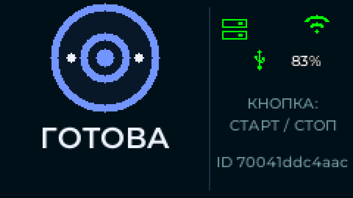

# Four-way screen orientation

The status screen uses a 500 ms stable gravity direction with a 0.20 g
axis-dominance margin. Samples outside 0.65..1.35 g, near-flat poses (Z above
0.75 g), low in-plane gravity, invalid reads and diagonal poses clear the pending
candidate while preserving the last orientation. Unsigned timestamp subtraction
handles wraparound. Startup orientation is portrait.

The official Bosch BMI270 driver uploads its configuration image once in a
separate FreeRTOS task, then configures 25 Hz +/-2 g acceleration and disables
the gyro. Shared I2C transactions have a 20 ms deadline; periodic reads run at
10 Hz. Missing sensor/configuration failure leaves recording and display running
in portrait. No sensor reset/reinitialization loop runs on the audio/display path.

Raw axes follow M5Unified `IMU_Class.inl` StickS3 mounting:
`board X = raw Y; board Y = -raw X; board Z = raw Z`.
Source: https://github.com/m5stack/M5Unified/blob/master/src/utility/IMU_Class.inl
The gravity-sign convention still needs confirmation on a physical device.

Portrait uses the upper area for state and the lower area for connectivity,
power and active input mode. Landscape uses separate state and indicator columns.
Long landscape messages replace the large state icon to gain text space. Setup
uses a 111 px QR including a four-module quiet zone; landscape places instructions
beside it. The physical LCD window remains x52..186/y40..279; software maps the
logical framebuffer to each rotation. Error/OTA/view selection remains in the
board adapter; the renderer receives that selected state.

Before hardware acceptance on ASUS: verify upright/each quarter-turn/signs,
500 ms settling, diagonal jitter, lying flat, absent sensor, recording and reply
playback while rotating, long errors, QR scanning and idle power consumption.
Code/native tests and successful build do not establish these physical results.
The user subsequently requested OTA publication; release 30 is now published.
Continue the existing connectivity/audio investigation in `recorder-handoff-2026-11-05.md`.

## Verification on 2026-11-05

Parent independently ran the final native suite: 149/149 cases passed. StickS3
target build passed. Read-only review found no blocking source-level issues.
Production renderer previews were inspected, including physical 135x240 frames
for all four rotations. The preview tool inverse-rotates those physical frames
and checks byte equality with logical frames. zxing-cpp decoded all eight setup
images (four logical, four physical) to the exact expected Wi-Fi payload.

[Preview sheet](screen-orientation-preview.png) is generated by
`python3 firmware/tools/render-screen-previews.py /tmp/zateya-screen-previews`.
It shows each physical frame rotated back to its viewing direction, hence the
matching appearances of 0/180 and 90/270. These checks preceded the OTA30 publication described below. No direct USB
flash was performed. Current copy fits the main column; arbitrary future longer text needs
new layout checks rather than assuming an unlimited text area.

## OTA30 publication

Published on explicit user request on 2026-11-05, revision
`baf6885f4641b58ae42187a9a89dab3103d44d0d`. Signed release build passed in
`/tmp/zateya-orientation-ota30/firmware`; rollback and two SNTP slots confirmed.
Image size: 1692320 bytes. SHA256:
`293a15675666c9d4ddc3540d1c34152d40ad198996d606c0e5cc045aec04946f`.
Server `stable.json` was atomically advanced from 29 to 30 after artifact upload
and public file permissions were set. External authenticated HTTPS verification
validated signature, complete image size/hash, unauthenticated rejection and
no-update HTTP204 for current sequence30. Backend restart was not needed.
Device installation, physical orientation and audio behavior remain unconfirmed.

## Landscape ready correction, 2026-11-06

User's physical photo showed no ready icon and ambiguous «НАЖМИТЕ ДЛЯ СТАРТА» /
«НАЖАТИЕ». The long-message rule hid the icon even for the ordinary multiline
ready hint. Selected ordinary landscape readiness now keeps its icon/title;
right column gives «КНОПКА: СТАРТ / СТОП» or «ДЕРЖИТЕ КНОПКУ». Wake-ready also
shows «СКАЖИТЕ ЗАТЕЯ». Other selected states retain their hints/timer; their right
column explicitly labels the button mode. Portrait, sensor and audio code unchanged.

Sol's three missing-icon pixel regressions failed before correction. Parent
reviewed the runtime/test/preview changes;156 native tests passed. Clean isolated
StickS3 build passed (221s), all159 tracked runtime files matched the reviewed
source snapshot. All32 logical/physical inverse transforms passed. Thirty-two
matched portrait frames and eight QR frames are byte-identical to the previous
renderer. QR decoding was not rerun: unchanged QR bytes match the earlier decoded
baseline. Parent inspected toggle/hold/wake/wake+hold and error/OTA/recording/setup.

Code committed/pushed as67fcff9718a09da4996b54d7e878bc73ae262513. Signed OTA32:
1692256bytes, SHA256 f536b926fcd41c63f1e20abe77c03bfd2ada217ffe957eae84521fa6811cfb6b.
Same signing key; rollback, two SNTP slots and PSRAM settings verified. Candidate
frozen in primary data/firmware/releases/32; server stable advanced31→32.
External authenticated download size/SHA and envelope signature checked; current32
returns204, unauthenticated401. No direct USB flash or cache erase. Device installation was confirmed after publication (see below). The user accepted the basic physical layout; button-side placement is a new
open correction (see below). Passive log:
/tmp/zateya-screen32-ota-install.log. Marina/Multilingual v2 server/cues unchanged.
Playback interference remains a separate task awaiting the promised recording.

Device logged `release 32 installed; rebooting` at6679668ms on the prior boot,
then selected app0x20000/ota_0. Persistent cache mounted at1763ms, backendHTTP200
at4853ms, and local self-test confirmed the image at18113ms. New boot_id536411533,
revision Nov6 00:52:12. The status frame flush took32ms. One M5PM1 setup timeout
was logged at17493ms; subsequent power telemetry reported4186mV/100%/USB1 at17913ms.
Do not describe this boot as wholly warning-free. Server cue generation remains
667fadd41d6bcc9b1f53492c9b09bef723090eb64cdbe63a709c44c2ee6728cf with14 files.
No user recording after this UI-only update has been claimed. User confirmed the basic physical layout, then noted that with the connector
on the left the physical button is left of the screen while its hint remains
on the right. Swapping column positions for that orientation was proposed but
not implemented before handoff. See [current handoff](recorder-handoff-2026-11-06-vector.md).
